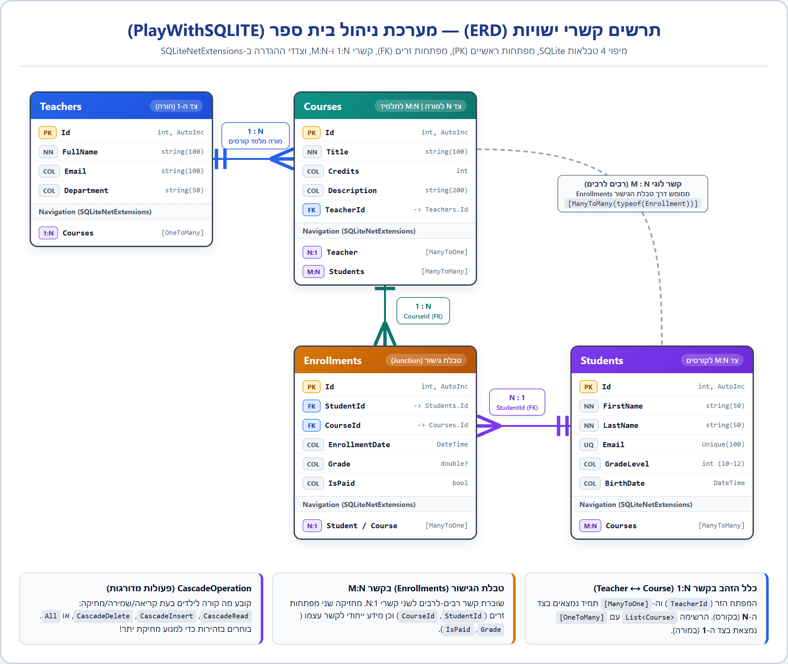

# 📦 שלב 1: התקנת חבילות NuGet, תכנון ERD, קשרי גומלין, CascadeOperation ודקורציות במודלים

בשלב זה נניח את **תשתית הנתונים** של המערכת:
1. נתקין בצורה ויזואלית את חבילות ה-NuGet היציבות (`Stable`) של SQLite.
2. נלמד לקרוא ולתכנן **תרשים קשרי ישויות (ERD)** ל-4 הטבלאות שלנו.
3. נבין לעומק **מהו קשר 1:N ומהו קשר M:N**, ו**איזה קישוט מגדירים בכל צד של הקשר**.
4. נלמד מהי פעולת **`CascadeOperation`** ומתי בוחרים כל ערך שלה.
5. נזהה ונשלים בעצמנו את הדקורציות (`Attributes`) בארבעת קובצי המודל בתיקיית `Models/`.

---

## 1. התקנת חבילות ה-NuGet המאושרות (ממשק ויזואלי — Stable בלבד!)

בפרויקט .NET MAUI נשתמש בשתי חבילות מאושרות בלבד:
1. **`sqlite-net-pcl`** (גרסה יציבה — Stable, למשל `1.11.285`): חבילת הבסיס האסינכרונית המספקת את `SQLiteAsyncConnection`, את דגלי הפתיחה `SQLiteOpenFlags`, ואת דקורציות הטבלאות (`[Table]`, `[PrimaryKey]` ועוד).
2. **`SQLiteNetExtensions.Async`** (גרסה יציבה — Stable `2.1.0`): הרחבה מעל `sqlite-net-pcl` המאפשרת להגדיר ולטעון קשרי גומלין (`1:1`, `1:N`, `M:N`) באופן אסינכרוני.

> [!IMPORTANT]
> **כלל ברזל — גרסאות יציבות (`Stable`) בלבד!**
> בעת החיפוש במנהל החבילות, **ודאו שתיבת הסימון "Include prerelease" / "Prerelease" אינה מסומנת**. התקנת גרסאות ניסיוניות (Beta / Preview) עלולה לגרום לשגיאות ריצה או אי-תאימות מול `SQLiteNetExtensions.Async`.

### 🖥️ אפשרות א': Visual Studio (Windows — VS 2026 / VS 2022)
1. בתפריט העליון לחצו על:  
   **`Tools`** ➡️ **`NuGet Package Manager`** ➡️ **`Manage NuGet Packages for Solution...`**  
   *(חלופה מהירה: קליק ימני על שם ה-Solution בחלון Solution Explorer ובחירה ב-`Manage NuGet Packages for Solution...`)*.
2. בחלק העליון של החלון שנפתח, עברו ללשונית **`Browse`** (עיון).
3. ודאו שתיבת הסימון **`Include prerelease`** לצד שורת החיפוש **מכובה (לא מסומנת)**.
4. **התקנת חבילת SQLite האסינכרונית:**
   - הקלידו בשורת החיפוש: `sqlite-net-pcl`
   - בחרו בחבילה הרשמית **`sqlite-net-pcl`** (מאת `Frank A. Krueger / Eric Sink`). שימו לב: **לא** לבחור `SQLite.Net-PCL` הישנה ולא `Microsoft.Data.Sqlite`.
   - בחלונית הפרויקטים בצד ימין, סמנו ב-✅ את הפרויקט **`PlayWithSQLITE`** בלבד (פרויקט הבדיקות מקבל אותה בירושה דרך `ProjectReference`).
   - ודאו שבשדה `Version` נבחרה הגרסה היציבה האחרונה (**Latest stable**), ולחצו על **`Install`** ואשרו את חלון הרישיון.
5. **התקנת חבילת קשרי הגומלין:**
   - הקלידו בשורת החיפוש: `SQLiteNetExtensions.Async`
   - בחרו בחבילה הרשמית **`SQLiteNetExtensions.Async`** (גרסה יציבה `2.1.0`).
   - סמנו ב-✅ את הפרויקט **`PlayWithSQLITE`** ולחצו על **`Install`**.

### 🍎 אפשרות ב': JetBrains Rider (macOS / Mac)
1. בחלון **Solution Explorer**, בצעו קליק ימני על פרויקט **`PlayWithSQLITE`** ובחרו **`Manage NuGet Packages`**  
   *(או מתפריט עליון: `Tools` ➡️ `NuGet` ➡️ `Manage NuGet Packages for Solution`)*.
2. לצד שורת החיפוש בחלונית ה-NuGet, ודאו שהכפתור/תיבה **`Prerelease`** **כבוי (Unchecked)**.
3. **התקנת החבילות:**
   - חפשו `sqlite-net-pcl`, בחרו בגרסת ה-**Stable** העדכנית, ולחצו על כפתור **`+` / `Install`** מול הפרויקט `PlayWithSQLITE`.
   - חפשו `SQLiteNetExtensions.Async`, בחרו בגרסת ה-**Stable** (`2.1.0`), ולחצו על **`+` / `Install`** מול הפרויקט `PlayWithSQLITE`.

> [!TIP]
> **איך מוודאים שההתקנה הצליחה?**
> ב-Solution Explorer, פתחו את `PlayWithSQLITE` ➡️ `Dependencies` ➡️ `Packages` וודאו ששתי החבילות מופיעות ללא סימני שגיאה, ושהפרויקט נבנה (`Build Solution`) ללא שגיאות.

---

## 2. תרשים קשרי ישויות (ERD — Entity-Relationship Diagram)

לפני שכותבים שורת קוד אחת במודלים, מתכננים את **מבנה מסד הנתונים** באמצעות תרשים **ERD**.  
התרשים מציג את 4 הטבלאות שלנו, את המפתחות הראשיים (`PK`), את המפתחות הזרים (`FK`), ואת סוג הקשר בין כל זוג טבלאות:

### קריאת התרשים — ארבע הטבלאות ותפקידן:
1. **`Teachers` (מורים):** ישות אב עצמאית. כל מורה מזוהה ע"י `Id` (`PK`) ויכול ללמד **אפס, אחד או יותר** קורסים.
2. **`Courses` (קורסים):** כל קורס שייך למורה אחד (`TeacherId` הוא `FK` המצביע אל `Teachers.Id`), ויכולים להירשם אליו תלמידים רבים.
3. **`Students` (תלמידים):** ישות עצמאית. לכל תלמיד `Id` (`PK`) וכתובת `Email` ייחודית (`Unique`), והוא יכול להירשם לקורסים רבים.
4. **`Enrollments` (רישומים — טבלת גישור / Junction Table):** שוברת את קשר הרבים-לרבים (`M:N`) בין תלמידים לקורסים לשני קשרי `1:N`, ומאפשרת לשמור גם מידע ייחודי על הרישום עצמו (`Grade`, `EnrollmentDate`, `IsPaid`).

---

## 3. איך מגדירים קשרים בין טבלאות — ומה מוגדר באיזה צד?

אחת הטעויות הנפוצות ביותר בתכנון מסדי נתונים היא בלבול בין **צד ה-1 (ההורה)** לבין **צד ה-N (הילד)**, והיכן מניחים את המפתח הזר (`ForeignKey`).

### א. קשר אחד-לרבים (`1:N`) — מורה וקורסים (`Teacher` ⟷ `Course`)
שאלו את עצמכם: **"למי יש הרבה ממה?"**  
למורה **אחד** (`1`) יש **הרבה** קורסים (`N`), אבל לכל קורס יש מורה **אחד**.

| צד הקשר | המחלקה | מה מוגדר במחלקה זו? | למה דווקא בצד הזה? |
| :--- | :--- | :--- | :--- |
| **צד ה-1 (הורה)** | `Teacher` | מאפיין ניווט מסוג רשימה (`List<Course> Courses`) עם הדקורציה **`[OneToMany]`** | בטבלת `Teachers` **אין** עמודת `CourseId` (כי אי אפשר לדחוס רשימת מזהים בעמודה אחת בטבלה יחסית!). הרשימה קיימת בזיכרון C# בלבד ונטענת לפי המפתח הזר בטבלת הקורסים. |
| **צד ה-N (ילד)** | `Course` | 1. עמודת מפתח זר: `int TeacherId` עם **`[ForeignKey(typeof(Teacher))]`** 2. מאפיין ניווט להורה: `Teacher? Teacher` עם **`[ManyToOne]`** | **כלל ברזל במסדי נתונים:** המפתח הזר (`FK`) יושב **תמיד** בצד ה-**N**! כל שורת קורס מצביעה למזהה של המורה האחד שמלמד אותה. |

### ב. קשר רבים-לרבים (`M:N`) — תלמידים וקורסים (`Student` ⟷ `Course`) דרך `Enrollment`
תלמיד אחד יכול ללמוד בקורסים רבים, וקורס אחד יכול להכיל תלמידים רבים. במסד נתונים יחסי **אי אפשר** לממש `M:N` ישירות בין שתי טבלאות — לכן יוצרים **טבלת גישור (`Enrollment`)**:

| תפקיד בקשר | המחלקה | מה מוגדר במחלקה זו? | תפקידו במערכת |
| :--- | :--- | :--- | :--- |
| **טבלת הגישור (צד ה-N לשניהם)** | `Enrollment` | 1. `int StudentId` עם **`[ForeignKey(typeof(Student))]`** 2. `int CourseId` עם **`[ForeignKey(typeof(Course))]`** 3. `Student? Student` עם **`[ManyToOne]`** 4. `Course? Course` עם **`[ManyToOne]`** | כל שורה ב-`Enrollments` מחברת בין תלמיד אחד לקורס אחד, ושומרת את הציון (`Grade`) ואת סטטוס התשלום (`IsPaid`). |
| **צד א' של ה-M:N** | `Student` | `List<Course> Courses` עם **`[ManyToMany(typeof(Enrollment))]`** | מאפשר לגשת ישירות לרשימת הקורסים של תלמיד דרך טבלת הגישור `Enrollment`. |
| **צד ב' של ה-M:N** | `Course` | `List<Student> Students` עם **`[ManyToMany(typeof(Enrollment))]`** | מאפשר לגשת ישירות לרשימת התלמידים הרשומים לקורס דרך טבלת הגישור `Enrollment`. |

---

## 4. מהו `CascadeOperation` ומתי משתמשים בכל ערך?

בספריית `SQLiteNetExtensions`, כאשר מגדירים קשר (`[OneToMany]`, `[ManyToOne]`, `[ManyToMany]`), ניתן לקבוע פרמטר בשם **`CascadeOperations`**.  
פרמטר זה קובע **האם פעולה שמתבצעת על ישות ההורה "תתגלגל" (Cascade) אוטומטית גם אל הישויות המקושרות אליה**:

| ערך (`CascadeOperation`) | מה הוא עושה בפועל? | מתי משתמשים בו? |
| :--- | :--- | :--- |
| **`CascadeOperation.None`** *(ברירת מחדל)* | שום פעולה לא מתגלגלת אוטומטית; שמירה/טעינה/מחיקה משפיעה רק על האובייקט הנוכחי. | כאשר רוצים שליטה ידנית מלאה ולא רוצים הפתעות. |
| **`CascadeOperation.CascadeRead`** | בעת קריאה ל-`GetWithChildrenAsync` / `GetAllWithChildrenAsync`, הילדים נטענים אוטומטית מהטבלה המקושרת. | כאשר תמיד רוצים לקבל את האובייקטים המקושרים בקריאה (למשל קורסים של מורה). |
| **`CascadeOperation.CascadeInsert`** | בעת שמירה עם `InsertWithChildrenAsync`, גם אובייקטים חדשים ברשימת הילדים נשמרים אוטומטית במסד. | כאשר יוצרים הורה וילדים יחד בזיכרון ורוצים לשמור הכל בפעולה אחת. |
| **`CascadeOperation.CascadeDelete`** | בעת מחיקה עם `Delete(entity, recursive: true)`, גם הילדים המקושרים נמחקים אוטומטית מהמסד כדי למנוע **רשומות יתומות (Orphan Records)**. | כאשר הילדים **אינם יכולים להתקיים ללא ההורה** (למשל קורסים שתלויים במורה או רישומים של תלמיד שנמחק). |
| **`CascadeOperation.All`** | שילוב של `CascadeRead \| CascadeInsert \| CascadeDelete`. | נפוץ בקשר `1:N` חזק (כמו `Teacher.Courses`) או לצורך הדגמה מלאה של פעולות מדורגות. |

> [!WARNING]
> **נקודה חשובה לחשיבה ולבחינת הבגרות!**
> בקשר `M:N` בין `Course` ל-`Student`, אם תפעילו מחיקה רקורסיבית (`DeleteAsync(..., recursive: true)`) כשמוגדר `CascadeOperation.All`, מחיקת קורס עלולה למחוק גם את **התלמידים עצמם** ולא רק את הרישומים שלהם!  
> לכן:
> - בקשר **בעלות (`Teacher` ➡️ `Courses`)** שימוש ב-`CascadeOperation.All` הגיוני (או `CascadeRead | CascadeInsert`).
> - בקשר **`M:N` (`Student` ⟷ `Course`)** במערכות ייצור מקובל להשתמש ב-`CascadeOperation.CascadeRead | CascadeOperation.CascadeInsert` ולמחוק באופן מבוקר רק את שורות ה-`Enrollment` בשכבת השירות (כפי שנראה בשלב 3!). בפרויקט שלנו תוכלו לבחור `CascadeRead | CascadeInsert` או `All` תוך הבנת ההשלכה במחיקה!

---

## 5. מילון הדקורציות (`Attributes`) המרכזיות

לפני שתיגשו לקובצי ה-`Models/`, הכירו את "ארגז הכלים" של הדקורציות שזמינות לכם לאחר התקנת החבילות:

### א. ממרחב השמות `using SQLite;` (חבילת `sqlite-net-pcl`)
| דקורציה | תפקיד ומשמעות |
| :--- | :--- |
| `[Table("Name")]` | קובעת במפורש את שם הטבלה במסד הנתונים (ברבים, למשל `"Teachers"`, `"Students"`). |
| `[PrimaryKey]` | מגדירה את העמודה כמפתח ראשי ייחודי של הטבלה. |
| `[AutoIncrement]` | מורה ל-SQLite להקצות אוטומטית מספר רץ (`1, 2, 3...`) לכל רשומה חדשה (`Id`). |
| `[NotNull]` | אוסרת שמירת ערך ריק (`NULL`) בעמודה זו (שדה חובה). |
| `[Unique]` | אוסרת כפילות ערכים בעמודה (למשל כתובת `Email` של תלמיד). |
| `[MaxLength(N)]` | מגבילה את מספר התווים המרבי המותר במחרוזת. |
| `[Ignore]` | מורה ל-SQLite **לא** ליצור עמודה עבור מאפיין מחושב (כמו `FullName` או `DisplayInfo` שנועדו רק ל-XAML). |

### ב. ממרחב השמות `using SQLiteNetExtensions.Attributes;` (חבילת `SQLiteNetExtensions.Async`)
| דקורציה | תפקיד ומשמעות |
| :--- | :--- |
| `[ForeignKey(typeof(TargetClass))]` | מסמנת עמודת מזהה (`int`) כמפתח זר המצביע לטבלה של `TargetClass`. |
| `[OneToMany(CascadeOperations = ...)]` | מונחת על רשימה (`List<Child>`) בצד ה-**1** (ההורה). |
| `[ManyToOne]` | מונחת על אובייקט הורה יחיד (`Parent?`) בצד ה-**N** (הילד או טבלת הגישור). |
| `[ManyToMany(typeof(JunctionClass), CascadeOperations = ...)]` | מונחת על רשימה בשני הצדדים של קשר `M:N`, תוך ציון טיפוס טבלת הגישור. |

---

## 6. משימתכם המעשית בשלב 1 (ללא Copy-Paste!)

פתחו את 4 הקבצים בתיקיית `PlayWithSQLITE/Models/`. בכל קובץ תמצאו שאלות מנחות לצד כל מאפיין. היעזרו ב**תרשים ה-ERD**, ב**טבלאות הצדדים**, וב**מילון הדקורציות** למעלה כדי להחליט בעצמכם אילו דקורציות להוסיף:

1. **[Teacher.cs](file:///c:/Users/Owner/source/repos/PlayWithSQLITE/PlayWithSQLITE/Models/Teacher.cs)**:
   - יבאו את שני מרחבי השמות הנדרשים.
   - הגדירו שם טבלה, מפתח ראשי עם מספור אוטומטי, שדות חובה ומגבלות אורך.
   - הגדירו את קשר ה-`1:N` מול `Courses` כולל `CascadeOperations`.
   - סמנו את המאפיין המחושב `DisplayInfo` כך שלא יישמר בטבלה.
2. **[Course.cs](file:///c:/Users/Owner/source/repos/PlayWithSQLITE/PlayWithSQLITE/Models/Course.cs)**:
   - הגדירו טבלה, מפתח ראשי, אילוצי `Title` ו-`Description`.
   - הגדירו את `TeacherId` כמפתח זר, את `Teacher` כמאפיין הניווט בצד ה-N, ואת `Students` כקשר `M:N` דרך `Enrollment`.
   - **אל תשכחו!** מהו המאפיין המחושב בסוף המחלקה (`TeacherName`) שאסור שיישמר כעמודה?
3. **[Student.cs](file:///c:/Users/Owner/source/repos/PlayWithSQLITE/PlayWithSQLITE/Models/Student.cs)**:
   - הגדירו טבלה, מפתח ראשי, אילוצי שם פרטי ומשפחה, ואילוץ ייחודיות על `Email`.
   - הגדירו את קשר ה-`M:N` מול `Courses`.
   - סמנו את **שני** המאפיינים המחושבים (`FullName` ו-`GradeLevelHebrew`) להתעלמות ע"י SQLite.
4. **[Enrollment.cs](file:///c:/Users/Owner/source/repos/PlayWithSQLITE/PlayWithSQLITE/Models/Enrollment.cs)**:
   - הגדירו את טבלת הגישור `"Enrollments"`, מפתח ראשי, שני מפתחות זרים (`StudentId` ו-`CourseId`), ושני מאפייני הניווט (`Student` ו-`Course`).

### ✅ בדיקה עצמית בסיום שלב 1:
- הריצו **Build Solution** ב-Visual Studio או ב-Rider וודאו שיש **0 שגיאות קומפילציה**.
- להשוואת הפתרון שלכם מול הענף המוכן: `git checkout step-01-packages-and-models` (וזכרו לחזור ל-`main` לאחר ההשוואה!).

עברו לשלב הבא: [02-Database-Connection-And-Basic-CRUD.md](file:///c:/Users/Owner/source/repos/PlayWithSQLITE/Learning/Guides/02-Database-Connection-And-Basic-CRUD.md).
