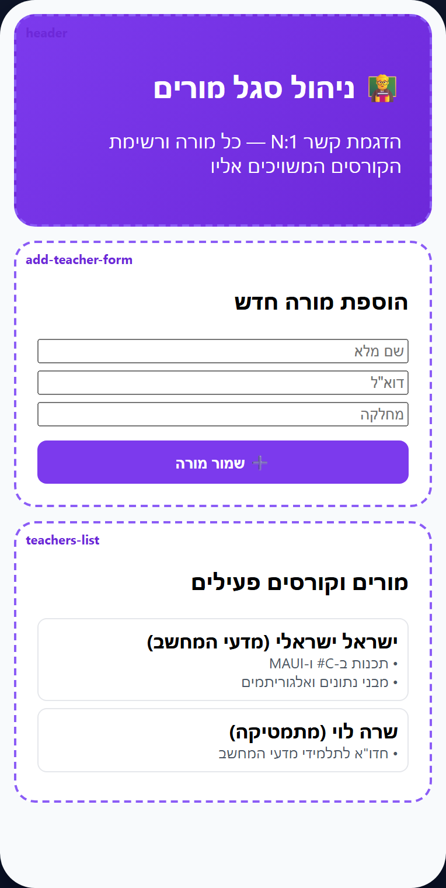
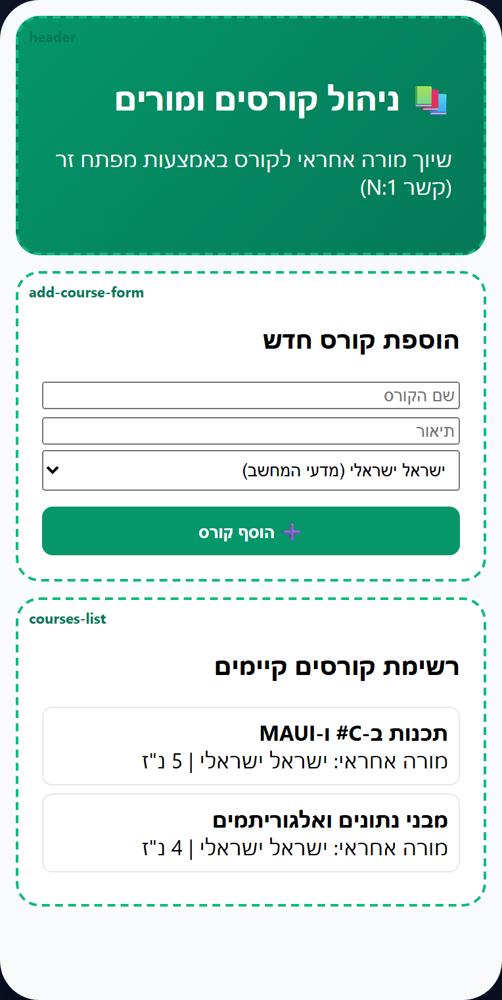
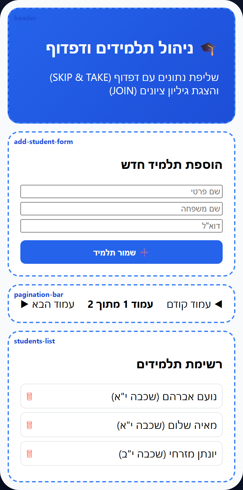
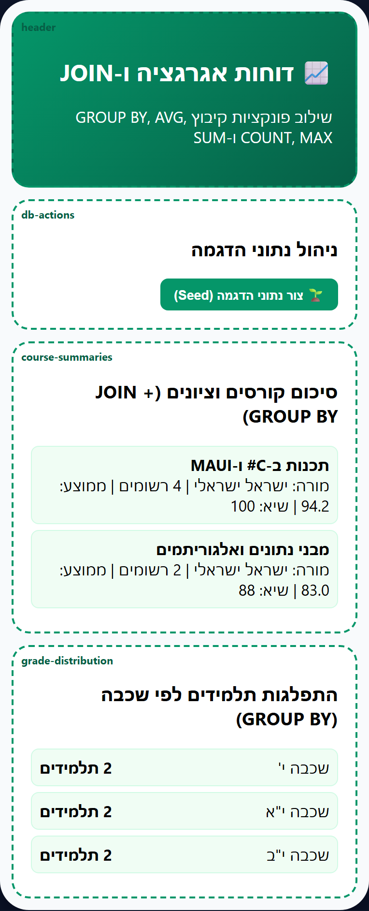

# 🧩 שלב 5: רישום ב-DI Container ויצירת פקודות (`ICommand`) ב-ViewModels להבאת נתונים מהמסד

עד שלב 4 בנינו ואמתנו את **שכבת הנתונים** במלואה (`Constants`, `Models`, `IDatabaseService`, `DatabaseService`).  
אבל אם תפעילו את האפליקציה עכשיו, תגלו שהמסכים עדיין ריקים והכפתורים אינם עושים דבר! מדוע?
1. ה-**DI Container** ב-`MauiProgram.cs` עדיין לא יודע איזה מימוש להזריק כשמסך מבקש `IDatabaseService`.
2. ה-**ViewModels** עדיין לא יוצרים את הפקודות (`ICommand`) ולא קוראים למתודות של `_databaseService`.

בשלב זה תחברו בעצמכם את שכבת הממשק (MVVM) לשכבת מסד הנתונים!

---

## 1. מהו DI Container וכיצד רושמים שירותים ב-`MauiProgram.cs`?

### מדוע **אסור** לכתוב `new DatabaseService()` בתוך כל ViewModel?
1. **ניהול חיבורים ונעילות:** אם כל מסך ייצור מופע נפרד של `DatabaseService`, ייפתחו מספר חיבורים נפרדים לאותו קובץ `.db3` — דבר שעלול לגרום לשגיאות נעילה (`Database is locked`) ולבזבוז זיכרון.
2. **צימוד קשיח (Tight Coupling):** ה-ViewModel צריך להכיר רק את החוזה **`IDatabaseService`**, ולא את המימוש הקונקרטי.
3. **בדיקות יחידה:** הזרקה דרך הבנאי (`Constructor Injection`) מאפשרת לבדוק ViewModels בבידוד.

### שרשרת ההזרקה האוטומטית ב-.NET MAUI:
```text
MauiProgram.cs (DI Container)
   │
   ├── מזריק את המופע היחיד של IDatabaseService (DatabaseService)
   │         ▼
   ├── לתוך הבנאי של StudentsViewModel(IDatabaseService databaseService)
   │         ▼
   └── לתוך הבנאי של StudentsPage(StudentsViewModel viewModel)  --> AppShell מציג את המסך!
```

### מחזורי החיים (Service Lifetimes) ב-`builder.Services`:

| שיטת רישום | כמה מופעים נוצרים? | למי היא מתאימה ב-MAUI? |
| :--- | :--- | :--- |
| **`AddSingleton<TInterface, TImpl>()`** | **מופע אחד יחיד** לכל זמן חיי האפליקציה (משותף לכל המסכים). | ✅ **שירות מסד הנתונים (`IDatabaseService` ➡️ `DatabaseService`)**! שומר חיבור אסינכרוני מנוהל אחד לכל המסכים. |
| **`AddTransient<T>()`** | **מופע חדש** בכל פעם שהשירות מתבקש. | ✅ **ViewModels ו-Pages** (`StudentsViewModel`, `StudentsPage` וכו') — כדי שכל פתיחה תקבל מצב מסך נקי. |
| **`AddScoped<T>()`** | מופע אחד לכל היקף (Scope). | נפוץ בשרתי Web (בקשת HTTP); ב-MAUI משתמשים בעיקר ב-Singleton ו-Transient. |

### משימה 5.0 — רישום שירות המסד ב-[MauiProgram.cs](file:///c:/Users/Owner/source/repos/PlayWithSQLITE/PlayWithSQLITE/MauiProgram.cs):
פתחו את `MauiProgram.cs`. תראו שכל ה-ViewModels וה-Pages כבר רשומים כ-`Transient`.  
הוסיפו במקום המסומן `TODO (Student - שלב 5)` את רישום הממשק `IDatabaseService` מול המימוש `DatabaseService` במחזור החיים המתאים (`Singleton`).

> [!TIP]
> **בדיקה אוטומטית של ה-DI:**  
> הריצו במסוף `.\Scripts\Audit-DI.ps1`!  
> לפני התיקון תקבלו `[MISSING DI] DatabaseService`, ולאחר הרישום הנכון תקבלו **`RESULT: PASS`**!

---

## 2. איך בונים פקודה (`ICommand`) ב-ViewModel להפעלת המסד? (תבנית 5 הצעדים)

בפרויקט זה אנו עובדים ב-**Vanilla C# MVVM** (מימוש מפורש של `INotifyPropertyChanged` ו-`ICommand`, ללא קיצורי Source Generators).  
בכל ViewModel יש כבר **שדות קלט**, **אוספי `ObservableCollection<T>`**, ומאפייני **`ICommand`** שמחוברים ל-XAML. כדי להחיות אותם, עבדו לפי 5 צעדים קבועים:

### צעד 1: הגדרת הפקודה בבנאי (`Command` / `Command<T>`)
- פקודה ללא פרמטר (למשל רענון או הוספה):  
  `new Command(async () => await MethodAsync())`
- פקודה עם תנאי הפעלה (`CanExecute`) — **מפעילה/משביתה את הכפתור ב-XAML אוטומטית ללא צורך ב-`IsEnabled`!**  
  `new Command(async () => await AddAsync(), CanAdd)`
- פקודה המקבלת פרמטר מהרשימה (`CommandParameter="{Binding .}"`, למשל כפתור מחיקה בשורה):  
  `new Command<Teacher>(async (teacher) => await DeleteAsync(teacher))`

### צעד 2: עדכון מצב הכפתור ב-Setters (`ChangeCanExecute`)
בכל מאפיין שמשפיע על תנאי `CanExecute` (למשל `NewFirstName`, `SelectedTeacher`, `CurrentPage`), ה-Setter קורא ל:
```csharp
(AddStudentCommand as Command)?.ChangeCanExecute();
```
בזכות שורה זו, ברגע שהמשתמש מקליד את התו האחרון החסר בטופס — הכפתור הופך מיד לפעיל!

### צעד 3: הגנת `IsLoading` עם `try / finally`
כדי להציג `ActivityIndicator` (גלגל טעינה) ולמנוע לחיצה כפולה על כפתור בזמן שהמסד עובד:
```csharp
if (IsLoading) return;
try
{
    IsLoading = true;
    await _databaseService.InitializeAsync();
    // ... קריאות למסד ועדכון האוספים ...
}
finally
{
    IsLoading = false; // מובטח שיכבה גם אם קרתה שגיאה!
}
```

### צעד 4: עדכון ה-`ObservableCollection`
מכיוון שה-`CollectionView` ב-XAML מאזין לשינויים ב-`ObservableCollection`, איננו מחליפים את המצביע של הרשימה, אלא:
1. מנקים את האוסף הקיים (`Items.Clear()`).
2. מוסיפים בלולאת `foreach` את הפריטים החדשים שהגיעו מהמסד (`Items.Add(item)`).

### צעד 5: רענון אוטומטי לאחר פעולות שינוי (`Save` / `Delete`)
בסיום כל פעולת הוספה, עדכון או מחיקה במסד:
1. מאפסים את שדות הטופס (למשל `NewFullName = string.Empty;`).
2. קוראים מחדש ל-`await Load...Async()` כדי שהמסך ישקף את המצב העדכני מהמסד!

---

## 3. מיפוי משימות התלמיד — 4 ה-ViewModels שלב אחר שלב

בצעו את החיבור בסדר הבא (מהקל אל המורכב):

### שלב 5.1 — [TeachersViewModel.cs](file:///c:/Users/Owner/source/repos/PlayWithSQLITE/PlayWithSQLITE/ViewModels/TeachersViewModel.cs) (מסך המורים)


- **פקודות לאתחול בבנאי:**
  1. `LoadTeachersCommand` ➡️ מפעילה את `LoadTeachersAsync()`.
  2. `AddTeacherCommand` ➡️ מפעילה את `AddTeacherAsync()` עם תנאי `CanAddTeacher`.
  3. `DeleteTeacherCommand` ➡️ `Command<Teacher>` המפעיל את `DeleteTeacherAsync(teacher)`.
- **מתודות להשלמה:**
  - `LoadTeachersAsync()`: קראו ל-`GetTeachersAsync()`, ועבור כל מורה טענו גם את קורסיו בעזרת `GetTeacherByIdAsync(item.Id, includeCourses: true)` כדי שמספר הקורסים של כל מורה יוצג בכרטיס!
  - `AddTeacherAsync()`: בנו `Teacher` חדש משדות הטופס, קראו ל-`SaveTeacherAsync`, נקו שדות ורעננו.
  - `DeleteTeacherAsync(Teacher? teacher)`: קראו ל-`DeleteTeacherAsync` ורעננו.

---

### שלב 5.2 — [CoursesViewModel.cs](file:///c:/Users/Owner/source/repos/PlayWithSQLITE/PlayWithSQLITE/ViewModels/CoursesViewModel.cs) (מסך הקורסים)


- **פקודות לאתחול בבנאי:** `LoadCoursesCommand`, `AddCourseCommand` (עם `CanAddCourse`), `DeleteCourseCommand` (`Command<Course>`).
- **מתודות להשלמה:**
  - `LoadCoursesAsync()`:
    1. שלפו מורים (`GetTeachersAsync()`) לתוך `Teachers` — כך ה-`Picker` לבחירת מורה יאוכלס!
    2. שלפו קורסים עם קשרים (`GetCoursesAsync(includeRelations: true)`) לתוך `Courses` — כך כל קורס יציג את שם המורה שלו!
  - `AddCourseAsync()`: צרו `Course` חדש והציבו **`TeacherId = SelectedTeacher!.Id`** (זהו המפתח הזר המקשר את הקורס למורה שנבחר ב-Picker!). שמרו ב-`SaveCourseAsync`, נקו שדות ורעננו.
  - `DeleteCourseAsync(Course? course)`: מחקו ב-`DeleteCourseAsync` ורעננו.

---

### שלב 5.3 — [StudentsViewModel.cs](file:///c:/Users/Owner/source/repos/PlayWithSQLITE/PlayWithSQLITE/ViewModels/StudentsViewModel.cs) (מסך התלמידים, דפדוף וגיליון ציונים)


- **5 פקודות לאתחול בבנאי:**
  1. `LoadStudentsCommand` ➡️ `LoadStudentsAsync()`
  2. `NextPageCommand` ➡️ `NextPageAsync()`, עם תנאי `CanExecute`: `() => CurrentPage < TotalPages`
  3. `PrevPageCommand` ➡️ `PrevPageAsync()`, עם תנאי `CanExecute`: `() => CurrentPage > 1`
  4. `AddStudentCommand` ➡️ `AddStudentAsync()`, עם תנאי `CanAddStudent`
  5. `DeleteStudentCommand` ➡️ `Command<Student>` המפעיל `DeleteStudentAsync(student)`
- **מתודות להשלמה:**
  - `LoadStudentsAsync()`: עדכנו `TotalStudents = await _databaseService.GetStudentsCountAsync();`, חשבו `int skip = (CurrentPage - 1) * _pageSize;`, ושלפו רק את העמוד הנוכחי ב-`GetStudentsAsync(skip, _pageSize)`.
  - `NextPageAsync()` / `PrevPageAsync()`: עדכנו את `CurrentPage` (ה-Setter כבר יקרא ל-`ChangeCanExecute()`!) וקראו ל-`LoadStudentsAsync()`.
  - `LoadTranscriptForStudentAsync(int studentId)`: מופעלת אוטומטית כשהמשתמש לוחץ על תלמיד (`SelectedStudent`)! שלפו את `GetStudentTranscriptAsync(studentId)` לתוך `SelectedStudentTranscript` ועדכנו את `StudentTotalCredits = await _databaseService.GetTotalCreditsForStudentAsync(studentId);`.
  - `AddStudentAsync()` ו-`DeleteStudentAsync(Student? student)`: שמירה/מחיקה וניקוי `SelectedStudent` במקרה שהתלמיד הנבחר נמחק.

---

### שלב 5.4 — [ReportsViewModel.cs](file:///c:/Users/Owner/source/repos/PlayWithSQLITE/PlayWithSQLITE/ViewModels/ReportsViewModel.cs) (מסך הדוחות והשאילתות)


- **3 פקודות לאתחול בבנאי:** `LoadReportsCommand`, `SeedDataCommand`, `ClearDataCommand`.
- **מתודות להשלמה:**
  - `LoadReportsAsync()`: קראו ל-`GetCourseGradeSummariesAsync()` (לתוך `CourseSummaries`) ול-`GetStudentDistributionByGradeLevelAsync()` (לתוך `GradeDistributions`). עטפו ב-`try / catch / finally` ועדכנו את `StatusMessage` בסיכום או בהודעת שגיאה ידידותית.
  - `SeedDataAsync()`: הפעילו `await _databaseService.SeedSampleDataAsync();` ולאחר מכן `await LoadReportsAsync();` כדי לראות את הדוחות מתמלאים מיד!
  - `ClearDataAsync()`: הפעילו `await _databaseService.ClearAllDataAsync();`, נקו את שני האוספים ועדכנו את `StatusMessage`.

---

### ✅ בדיקה עצמית בסיום שלב 5:
1. הריצו `.\Scripts\Audit-DI.ps1` וודאו תוצאה **`RESULT: PASS`**.
2. הפעילו את האפליקציה (Android Emulator או Windows), היכנסו ללשונית **דוחות**, לחצו על **זריעת נתוני הדגמה**, ועברו בין כל 4 הלשוניות (`תלמידים`, `קורסים`, `מורים`, `דוחות`) כדי לוודא שכל הפקודות פועלות!
3. להשוואה מול הפתרון המוכן: `git checkout step-05-di-and-viewmodels`.

עברו לשלב האחרון: [06-Testing-And-Verification.md](file:///c:/Users/Owner/source/repos/PlayWithSQLITE/Learning/Guides/06-Testing-And-Verification.md).
